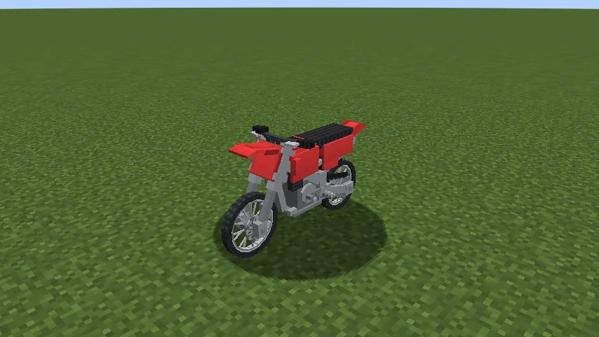
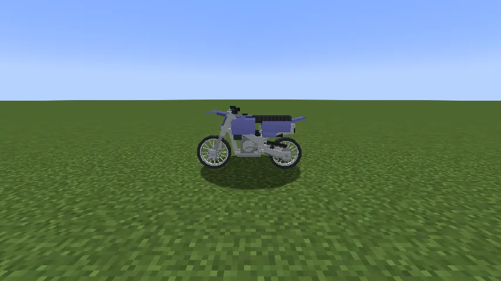
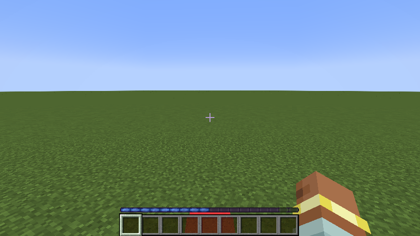
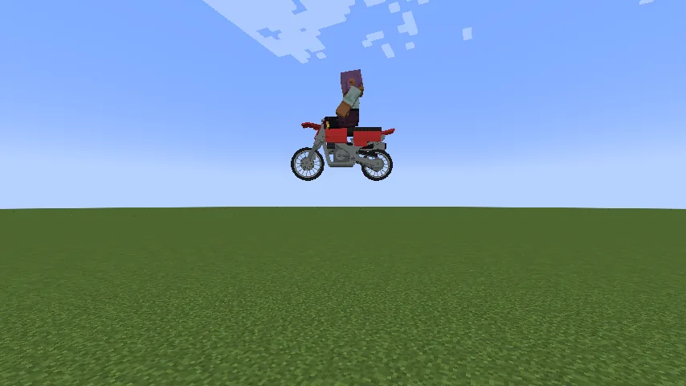
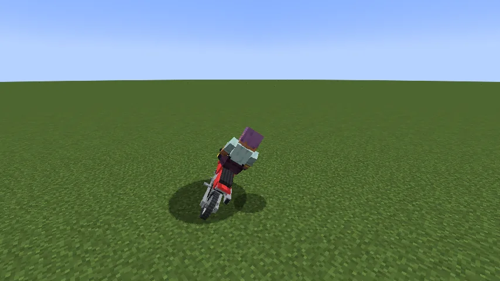
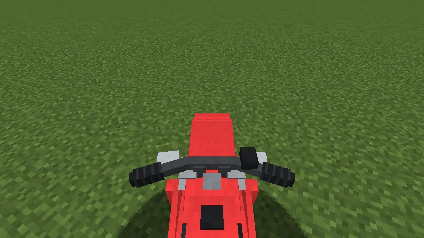

The **Scrambler** is a red dirt bike. It seats one, it is light and quick, it leans into its turns,
and it **jumps the way a horse does**. Everything else about riding it (fuel, keys, packing it up,
repairs) is [Vanilla Wheels](/wiki/vanilla-wheels)'s, so read that page too.

## Getting one

1. **The chassis:** six steel ingots in a frame's shape: one in the top right, a row of three across
   the middle, and one in each bottom corner. Steel comes from
   [Metals and Materials](/wiki/metals-and-materials).
2. **The parts:** **two wheels** and an **engine** (recipes on the
   [Vanilla Wheels](/wiki/vanilla-wheels#building-the-mechanic-lift) page).
3. **Build it** on a **Mechanic Lift**: chassis, wheels and engine in its slots, then **Build**. Put a
   dye in the lift and press **Paint** to colour it.
4. **Fuel it:** hold right-click at it with a full gas can.

## Riding it

- **Right-click** to get on; **crouch** to get off.
- **Movement keys** ride. It leans into every turn, further the faster and tighter you go.
- **Jump:** hold **Space**. The **jump bar** fills where your experience bar was, as on a horse. Let
  go, and it jumps with what the bar held: a full bar (about half a second) takes it **three blocks
  up**, enough to clear a two-block wall at speed; a tap barely leaves the ground. Holding Space never
  drifts it.
- **Landing** never hurts you or the bike, even jumping off a three-block drop.

## What it can do

| | |
|---|---|
| Top speed | 0.75 blocks a tick (15 m/s) |
| Jump | three blocks up at a full bar |
| Climbs | one-block steps; jump anything taller |
| Size | 2½ blocks long, 1 wide; fits on either Mechanic Lift |
| Tank | half a truck's |

## Repairs

- **By hand:** right-click a damaged Scrambler; it costs hunger, no materials.
- **On the Mechanic Lift:** a full repair costs **6 steel ingots**; a partial one less.

